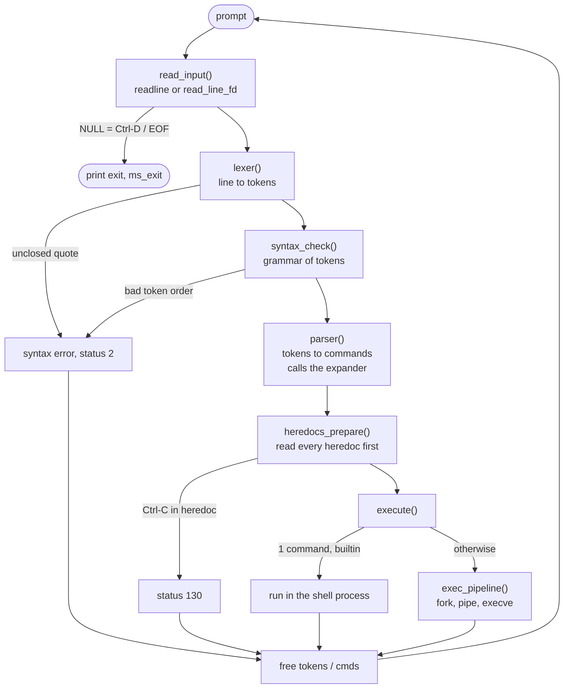
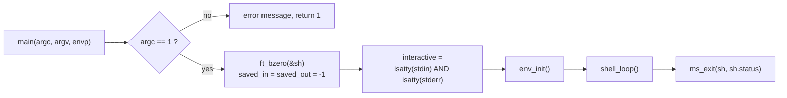
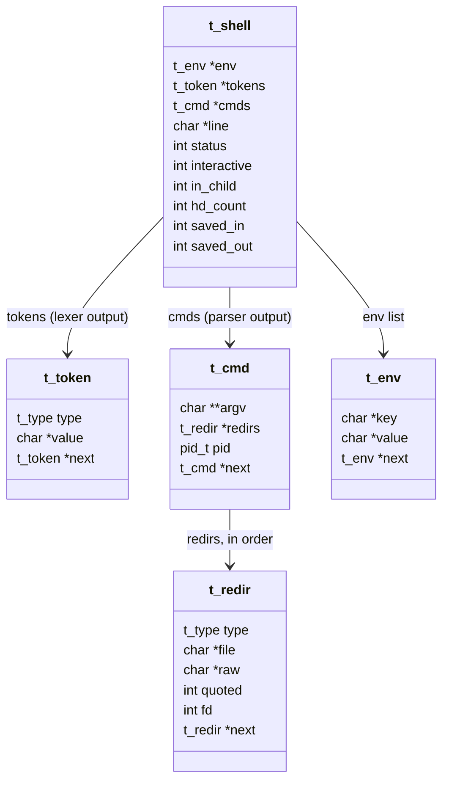

# `src/` — How minishell works

This folder holds all of minishell's source code. Each sub-folder is one stage
(or one service) of the shell and has its own `README.md` with the details.

| Folder | Role | Read |
|---|---|---|
| [`main.c`](main.c) | Entry point: checks args, builds the shell state, starts the loop | below |
| [`core/`](core/) | Main loop, line reading, error printing, cleanup / exit | [core/README.md](core/README.md) |
| [`lexer/`](lexer/) | Cuts the line into tokens, then checks the grammar | [lexer/README.md](lexer/README.md) |
| [`expander/`](expander/) | `$VAR`, `$?`, quote removal, word splitting | [expander/README.md](expander/README.md) |
| [`parser/`](parser/) | Turns tokens into a list of commands with their redirections | [parser/README.md](parser/README.md) |
| [`executor/`](executor/) | Heredocs, redirections, pipes, `fork`/`execve`, `PATH` lookup | [executor/README.md](executor/README.md) |
| [`builtins/`](builtins/) | `echo`, `cd`, `pwd`, `export`, `unset`, `env`, `exit` | [builtins/README.md](builtins/README.md) |
| [`env/`](env/) | The environment as a linked list (get / set / unset / to `char **`) | [env/README.md](env/README.md) |
| [`signals/`](signals/) | Ctrl-C / Ctrl-\ behaviour in every phase | [signals/README.md](signals/README.md) |
| [`utils/`](utils/) | Small helpers that are not in libft | [utils/README.md](utils/README.md) |

All prototypes and structures live in [`../include/minishell.h`](../include/minishell.h).
Generic string / memory / list helpers come from [`../libft`](../libft).

---

## 1. The big picture: life of one command line

Every line typed goes through the same pipeline. If a stage fails, the line is
dropped, `$?` is set, and the shell returns to the prompt.



The code of this loop is only ~30 lines: see `shell_loop()` and
`process_line()` in [`core/shell.c`](core/shell.c).

---

## 2. Entry point — `main.c`



* `interactive` decides almost everything that is "terminal only":
  showing a prompt with `readline`, adding to history, printing `exit`,
  the Ctrl-C handler. When stdin is a pipe or a file (like in the tester),
  minishell reads raw lines and prints no prompt — exactly like bash.
* The whole shell state lives in **one** stack variable `t_shell sh`, passed by
  pointer everywhere. The only global is `g_signal` (see [signals](signals/README.md)).

---

## 3. The data structures



| Field | Meaning |
|---|---|
| `status` | The value of `$?`. Updated after every line. |
| `interactive` | stdin **and** stderr are terminals. |
| `in_child` | Set to 1 in forked children (so `exit` does not print `exit`, etc.). |
| `hd_count` | Counter used to build unique heredoc temp file names. |
| `saved_in` / `saved_out` | Copies of fd 0 / 1 while a builtin runs with redirections in the parent. |

`t_type` is shared by tokens and redirections:

```
T_WORD   T_PIPE   T_IN (<)   T_OUT (>)   T_APPEND (>>)   T_HEREDOC (<<)
```

---

## 4. A complete example

Line: `cat << EOF | grep "$USER" > out.txt`

```
 1. LEXER            ┌──────┬────────┬─────┬──────┬──────┬─────────┬─────┬─────────┐
    (tokens)         │ WORD │HEREDOC │WORD │ PIPE │ WORD │  WORD   │ OUT │  WORD   │
                     │ cat  │  <<    │ EOF │  |   │ grep │"$USER"  │  >  │ out.txt │
                     └──────┴────────┴─────┴──────┴──────┴─────────┴─────┴─────────┘
 2. SYNTAX CHECK     every operator is followed by a WORD, no pipe at the edges → OK

 3. PARSER + EXPANDER
    cmd 1: argv = ["cat"]                 redirs = [HEREDOC file="EOF" quoted=0]
                                                          │
    cmd 2: argv = ["grep", "minks"]       redirs = [OUT   file="out.txt"]
                       ▲
                       └── "$USER" expanded, quotes removed, no splitting (quoted)

 4. HEREDOCS         child process reads lines until "EOF", writes them
                     (with $ expanded) to /tmp/.minishell_heredoc_N,
                     parent re-opens it read-only, unlinks it, keeps the fd
                     in redirs->fd

 5. EXECUTOR         fork #1: stdin  ← heredoc fd, stdout → pipe → execve(/bin/cat)
                     fork #2: stdin  ← pipe,       stdout → out.txt → execve(/usr/bin/grep)
                     parent waits for both, $? = exit status of grep
```

---

## 5. Memory ownership per line

| Data | Created by | Freed by |
|---|---|---|
| `sh->line` | `readline` / `read_line_fd` | end of the loop iteration in `shell_loop` |
| `sh->tokens` | `lexer` | `process_line`, right after parsing (or after a syntax error) |
| `sh->cmds` (+ argv, redirs, heredoc fds) | `parser` | `process_line`, after execution |
| `sh->env` | `env_init`, `export`, `cd` | `ms_exit` only |

Every forked child also calls `ms_exit()` (never plain `exit()`), so it frees
its copy of everything before leaving — this keeps valgrind clean in children too.

Allocation failures never return `NULL` into the logic: every `malloc` is
wrapped in `ms_check()` which prints `fatal error: out of memory` and exits.

---

## 6. Exit status cheat-sheet (`$?`)

| Situation | Status | Where |
|---|---|---|
| Syntax error / unclosed quote | 2 | `core/error.c` `syntax_error` |
| Command not found / file not found | 127 | `executor/path.c` |
| Found but not executable / is a directory | 126 | `executor/path.c` |
| Redirection failed (missing file, permission, ambiguous) | 1 | `executor/redirections.c` |
| Killed by signal N | 128 + N (Ctrl-C → 130, Ctrl-\ → 131) | `executor/pipeline.c` `wait_all` |
| Ctrl-C at the prompt | 130 | `core/shell.c` |
| Pipeline | status of the **last** command | `executor/pipeline.c` |
| `exit abc` | 2 | `builtins/bi_exit.c` |
| `exit 1 2`, `cd a b` | 1 (shell does not exit) | `builtins/` |
