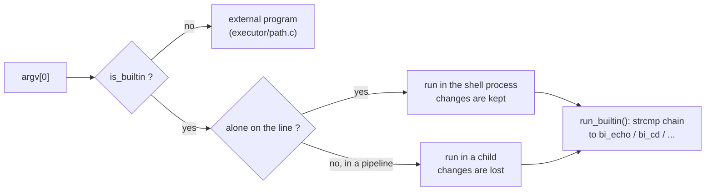
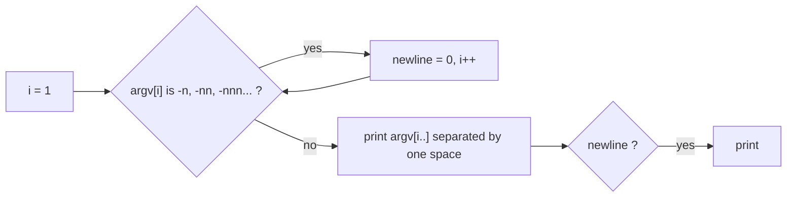
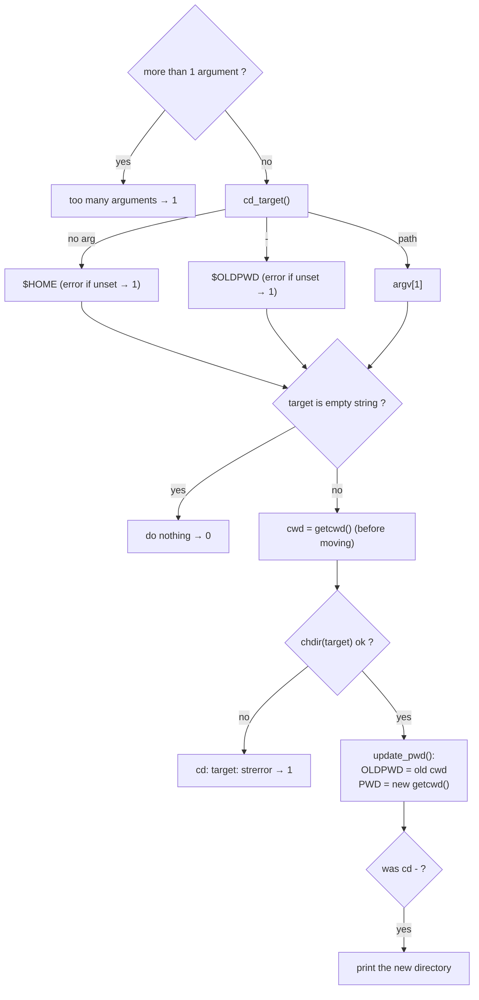
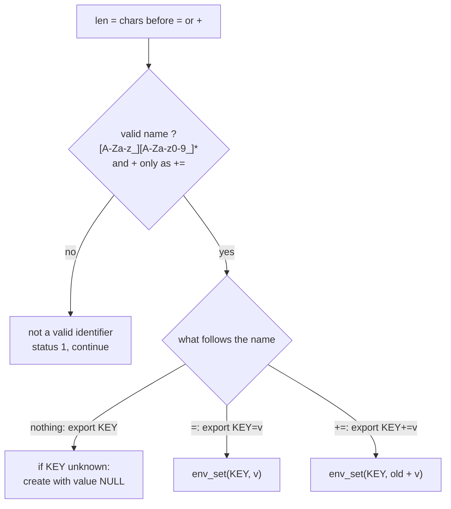
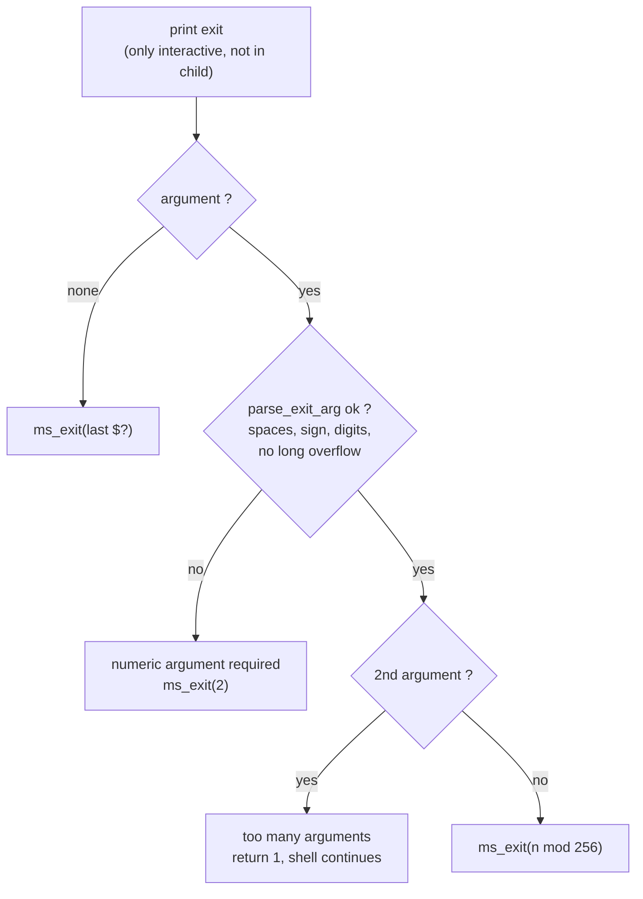

# `builtins/` — Commands implemented inside the shell

The subject requires seven builtins. They are plain C functions taking `argv`
and returning the exit status (`$?`).

| File | Functions | Builtin |
|---|---|---|
| [`builtin.c`](builtin.c) | `is_builtin`, `run_builtin` | Recognition + dispatch |
| [`bi_echo.c`](bi_echo.c) | `bi_echo`, `is_n_flag`* | `echo [-n] ...` |
| [`bi_cd.c`](bi_cd.c) | `bi_cd`, `cd_target`*, `update_pwd`* | `cd [dir]` |
| [`bi_pwd_env.c`](bi_pwd_env.c) | `bi_pwd`, `bi_env`, `bi_unset` | `pwd`, `env`, `unset` |
| [`bi_export.c`](bi_export.c) | `bi_export`, `is_valid_name`, `export_one`*, `export_assign`* | `export` |
| [`bi_export_print.c`](bi_export_print.c) | `export_print`, `sort_env`*, `print_entry`*, `print_escaped`* | `export` without args |
| [`bi_exit.c`](bi_exit.c) | `bi_exit`, `parse_exit_arg`* | `exit [n]` |

`*` = `static`

---

## 1. Dispatch and where builtins run



`run_builtin` falls through to `bi_exit` at the end: `is_builtin` was already
checked, so the only name left is `exit`.

---

## 2. `echo`



| Command | Output |
|---|---|
| `echo a b` | `a b⏎` |
| `echo -n a` | `a` |
| `echo -nnn -n a` | `a` |
| `echo -na` | `-na⏎` (not a valid flag → printed) |
| `echo a -n` | `a -n⏎` (flags only at the start) |

---

## 3. `cd`



If the old directory was deleted (`getcwd` fails), `OLDPWD` falls back to the
old `$PWD` value.

---

## 4. `pwd`, `env`, `unset`

| Builtin | Behaviour | Status |
|---|---|---|
| `pwd` | `getcwd()`; if the directory was deleted, prints `$PWD` instead. Arguments are ignored. | 0, or 1 if both fail |
| `env` | Prints `KEY=value` for every variable **that has a value** (`export X` alone is hidden). | 0 |
| `env arg` | `env: arg: No such file or directory` (no options/args in the subject) | 127 |
| `unset A B` | Removes each name. Unknown names are ignored. | 0 |
| `unset 1A` | ``unset: `1A': not a valid identifier``, continues with the others | 1 |

---

## 5. `export`

### With arguments — `export_one` for each



| Command | Result |
|---|---|
| `export A` | `A` declared, no value (visible in `export`, not in `env`) |
| `export A=` | `A` = empty string (visible in both) |
| `export A=1 B=2` | both set |
| `export A+=x` | `A` = old value + `x` (or `x` if unset) |
| `export 1A`, `export A-=1`, `export =` | invalid identifier, `$?` = 1 |

### Without arguments — `export_print`

```
1. copy the env list pointers into an array
2. bubble sort by key (ms_strcmp)
3. print each one, except "_":
       declare -x KEY="value"      (value escaped: \"  \\  \$  \`)
       declare -x KEY              (no value)
```

The list itself is never reordered: only the temporary array is sorted.

---

## 6. `exit`



| Command | Exits? | Status |
|---|---|---|
| `exit` | yes | last `$?` |
| `exit 42` / `exit " +42 "` | yes | 42 |
| `exit 298` | yes | 42 (298 mod 256) |
| `exit -1` | yes | 255 |
| `exit abc`, `exit 9223372036854775808` | yes | 2 |
| `exit 1 2` | **no** | 1 |

> **Note on bash versions:** `cd a b` and `exit 1 2` return **1** here, like
> bash ≤ 5.2 (the version on most Linux / 42 machines). bash 5.3 changed this
> to **2**. The value is the `return (1);` after `too many arguments` in
> [`bi_cd.c`](bi_cd.c) and [`bi_exit.c`](bi_exit.c).
