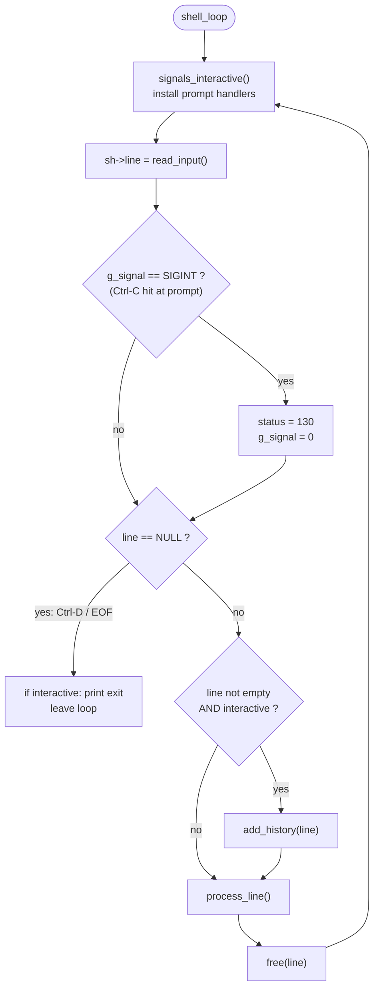
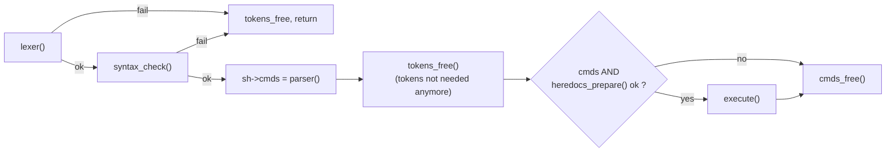
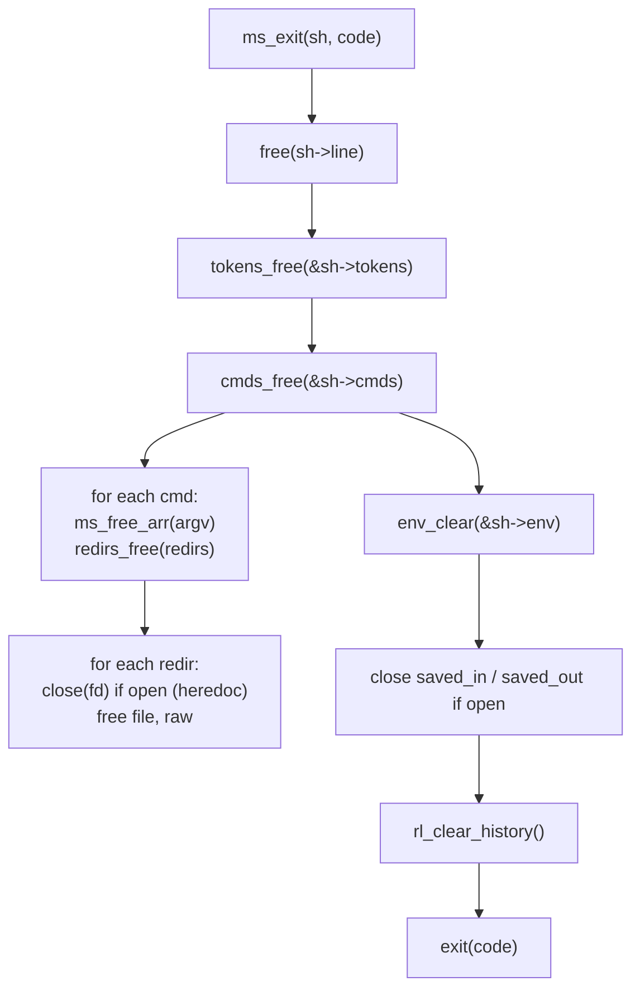

# `core/` — Main loop, input, errors and cleanup

The core is the "glue" of the shell: it reads lines, sends them through the
pipeline (lexer → parser → executor), prints errors in a uniform format and
frees everything when the shell (or a child) leaves.

| File | Functions | Role |
|---|---|---|
| [`shell.c`](shell.c) | `shell_loop`, `process_line`*, `read_input`* | The REPL (read–eval–print loop) |
| [`read_line.c`](read_line.c) | `read_line_fd`, `append_char`* | Read one line without readline (non-interactive mode) |
| [`error.c`](error.c) | `ms_check`, `ms_error`, `ms_error_id`, `syntax_error` | All error messages |
| [`cleanup.c`](cleanup.c) | `tokens_free`, `cmds_free`, `redirs_free`*, `ms_exit` | Freeing memory, leaving the shell |

`*` = `static` (private to the file)

---

## 1. `shell.c` — the loop



### `read_input`

| Mode | Function used | Prompt |
|---|---|---|
| interactive (`isatty`) | `readline(PROMPT)` | `minishell$ ` |
| non-interactive (pipe / file) | `read_line_fd(STDIN_FILENO)` | none |

### `process_line`



Notice that the tokens are freed **before** execution: after parsing,
everything needed is inside `sh->cmds`. This keeps children lighter.

---

## 2. `read_line.c` — reading without readline

When stdin is not a terminal, using `readline` would print the prompt and echo
input. Instead `read_line_fd` reads **one byte at a time** until `\n` or EOF:

```
input on fd:   e c h o ␣ h i \n l s \n
               └────────┬─────────┘
read_line_fd →  "echo hi"        (the '\n' is consumed, not stored)
read_line_fd →  "ls"
read_line_fd →  NULL             (EOF and nothing read)
```

| Case | Return |
|---|---|
| characters then `\n` or EOF | the characters (malloc'd) |
| `\n` alone (empty line) | `""` (malloc'd), so the loop continues |
| EOF with nothing read | `NULL` → loop ends like Ctrl-D |

Reading byte by byte is slower than a buffer, but it never reads past the
current line. That matters: a heredoc child or a command like `cat` started by
minishell must find the *rest* of stdin untouched.

`append_char` grows the buffer by one (`malloc(len + 2)` + `ft_memcpy`).

---

## 3. `error.c` — one format for every error

| Function | Output | Used for |
|---|---|---|
| `ms_check(ptr)` | `minishell: fatal error: out of memory` → `exit(1)` | wraps **every** allocation |
| `ms_error(s1, s2, s3)` | `minishell: s1: s2: s3` (NULL parts skipped) | most errors |
| `ms_error_id(cmd, arg)` | ``minishell: cmd: `arg': not a valid identifier`` | `export`, `unset` |
| `syntax_error(sh, tok)` | ``minishell: syntax error near unexpected token `tok'`` or `... unclosed quote` (tok == NULL) | lexer / syntax check, sets `status = 2`, returns 0 |

Examples:

```
ms_error("cd", "foo", "No such file or directory")
  → minishell: cd: foo: No such file or directory
ms_error("ls", "command not found", NULL)
  → minishell: ls: command not found
```

**Why build the message in a buffer?** `ms_error` assembles the full line
with `ft_strlcpy` / `ft_strlcat` into a 1024-byte buffer and calls `write`
**once**. When several children of a pipeline fail at the same time, their
messages cannot be interleaved in the middle of a line.

---

## 4. `cleanup.c` — freeing and exiting



* `ms_exit` is the **only** way the program ends (except `ms_check` on OOM).
  It is used by the main process, by every forked child, by heredoc children
  and by the `exit` builtin.
* All free functions take a `**` and set the pointer back to `NULL`, so calling
  them twice is harmless.
* `redirs_free` also closes heredoc fds that were opened but never used
  (for example when a previous command of the line failed).
