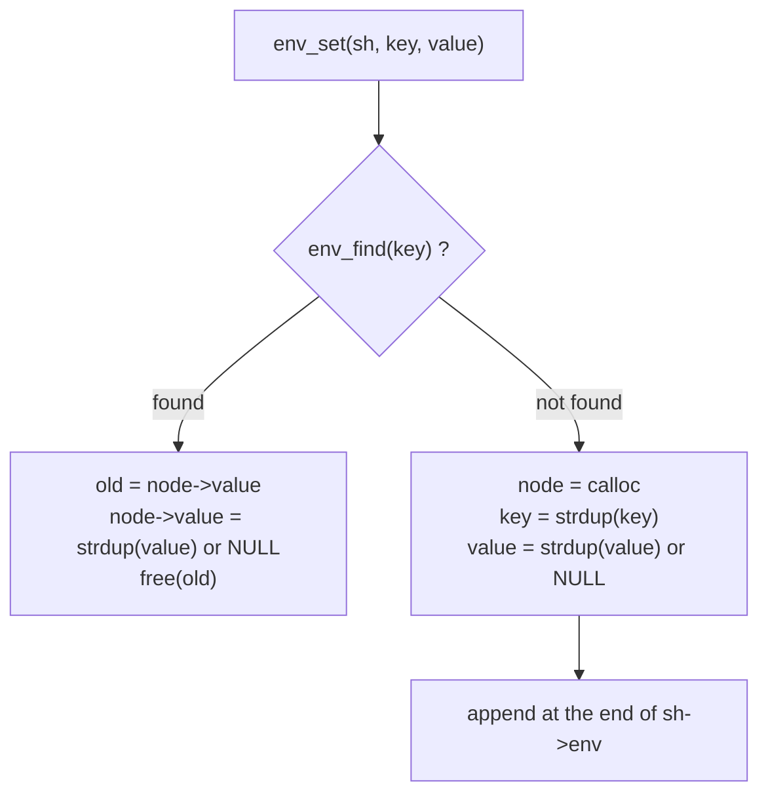
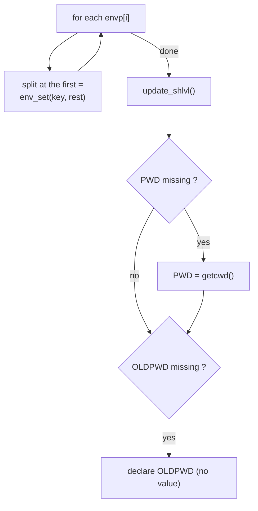

# `env/` — The environment

minishell keeps its own copy of the environment as a linked list of `t_env`.
`export`, `unset`, `cd` and the expander work on this list; it is converted
back to a `char **` only when a program is executed.

| File | Functions | Role |
|---|---|---|
| [`env.c`](env.c) | `env_find`, `env_get`, `env_set`, `env_unset`, `env_clear` | Basic operations on the list |
| [`env_utils.c`](env_utils.c) | `env_init`, `env_size`, `env_to_arr`, `update_shlvl`* | Start-up, conversion to `char **` |

`*` = `static`

---

## 1. Structure

```c
typedef struct s_env {
    char          *key;     // "PATH"
    char          *value;   // "/bin:/usr/bin"  — or NULL
    struct s_env  *next;
} t_env;
```

```
sh->env
  │
  ▼
┌──────────────┐   ┌──────────────┐   ┌──────────────┐   ┌──────────────┐
│ key  "HOME"  │──►│ key  "PATH"  │──►│ key  "SHLVL" │──►│ key "OLDPWD" │──► NULL
│ val  "/Us.." │   │ val  "/bin.."│   │ val  "2"     │   │ val  NULL    │
└──────────────┘   └──────────────┘   └──────────────┘   └──────────────┘
```

**`value == NULL` is meaningful**: the variable is declared (`export X`) but
has no value. It is different from `value == ""` (`export X=`).

| | `export` listing | `env` listing | passed to programs | `$X` |
|---|---|---|---|---|
| `value = NULL` | `declare -x X` | hidden | no | empty |
| `value = ""` | `declare -x X=""` | `X=` | yes | empty |

Why a list and not the original `envp`? `envp` cannot grow, and its strings
are not ours to free. With a list, adding / removing / replacing is simple and
every string is owned (and freed) by minishell.

---

## 2. Operations (`env.c`)

| Function | Behaviour |
|---|---|
| `env_find(env, key)` | Returns the node with that key, or `NULL`. |
| `env_get(env, key)` | Returns the value (not a copy!), or `NULL` if missing **or** without value. |
| `env_set(sh, key, value)` | Key exists → replace value (copy). Otherwise → append a new node at the **end** (keeps the original order). `value` may be `NULL`. |
| `env_unset(sh, key)` | Unlinks and frees the node; does nothing if absent. |
| `env_clear(&env)` | Frees the whole list (called by `ms_exit`). |

`env_set` always duplicates `key` and `value`, so callers can pass temporary
strings and free them afterwards:



In `env_set`, `old` is freed **after** the copy, so `env_set(sh, "A", env_get(sh->env, "A"))`
(value pointing into the same node) is safe.

---

## 3. Start-up (`env_init`)



### `SHLVL`

Each new shell is one level deeper:

| Inherited `SHLVL` | New value |
|---|---|
| missing / not a number | 1 |
| `1` | 2 |
| negative (`-5`) | 0 |
| `999` or more | 1, with `warning: shell level too high, resetting to 1` |

Try it: `./minishell` then `./minishell` again, then `echo $SHLVL`.

---

## 4. Back to `char **` (`env_to_arr`)

`execve` needs `char *envp[]` in the `"KEY=value"` format:

```
t_env list                          char **
─────────────                       ────────────────────────
HOME  = "/Users/me"        ──►      "HOME=/Users/me"
PATH  = "/bin:/usr/bin"    ──►      "PATH=/bin:/usr/bin"
OLDPWD = NULL              ──►      (skipped)
                                    NULL
```

It is built in the child right before `execve` (in
[`executor/path.c`](../executor/path.c)), so it always reflects the current
state of the shell.
