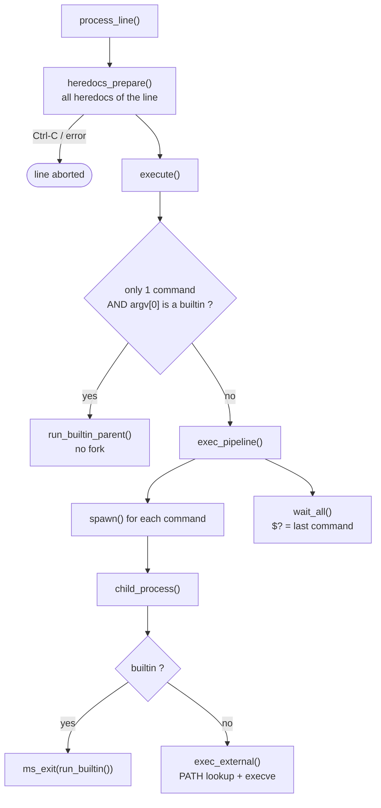
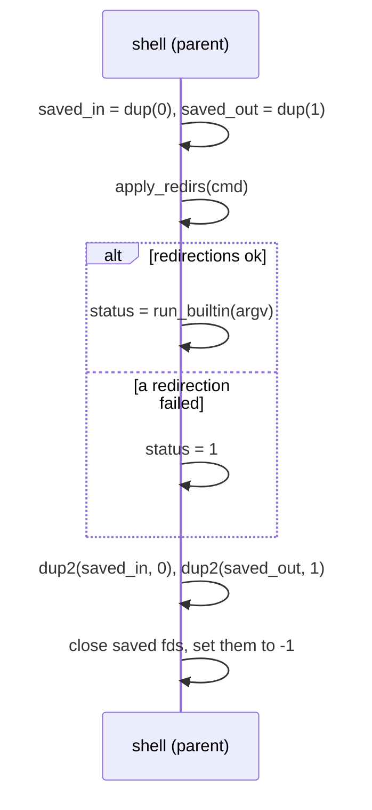
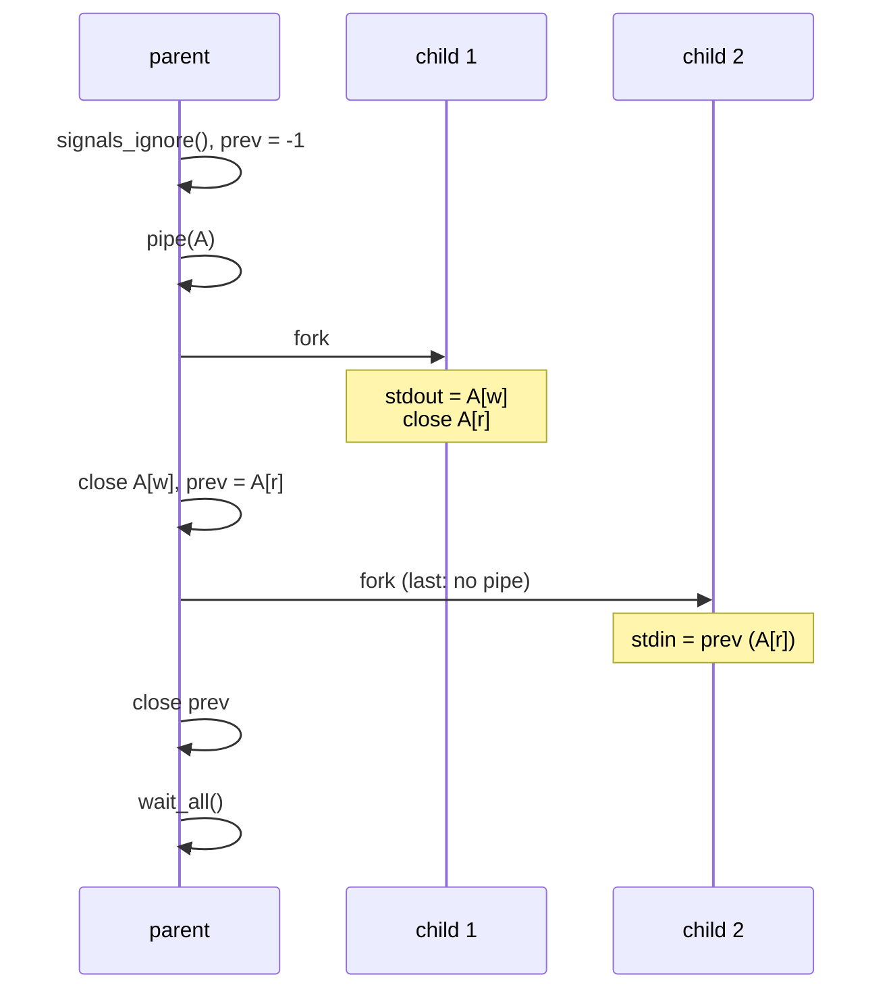
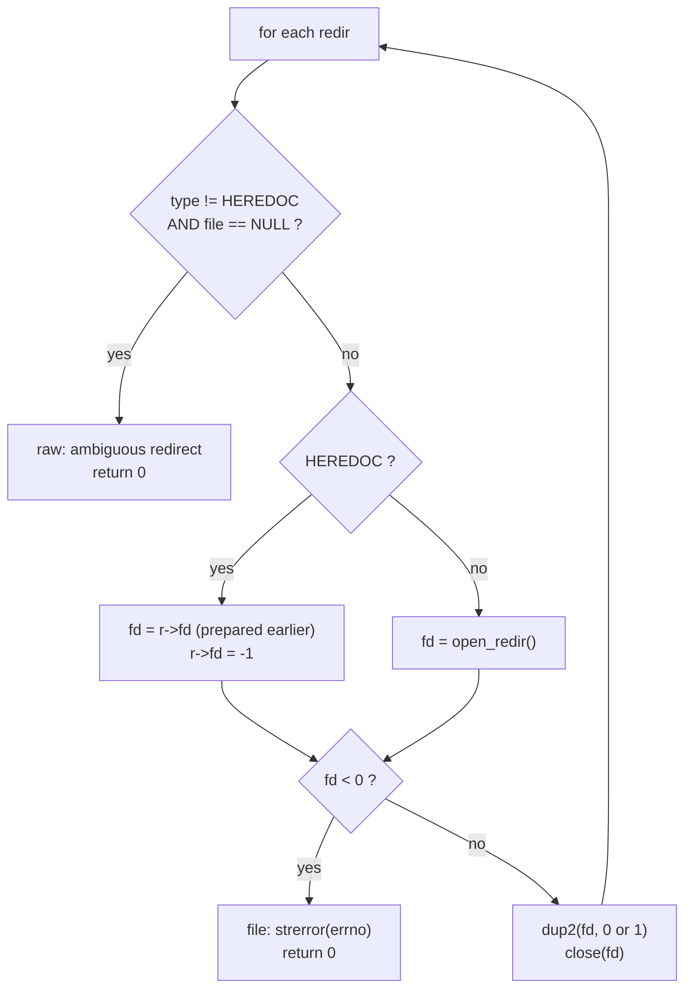
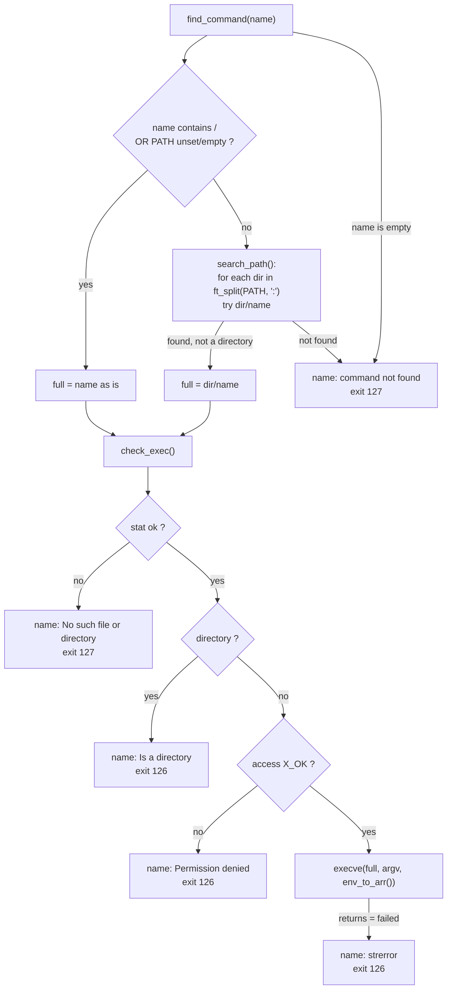
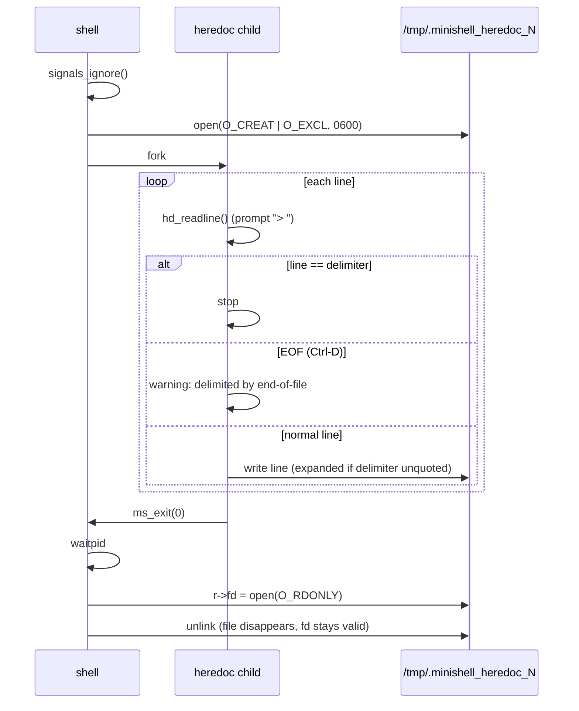

# `executor/` — Running the commands

The executor receives the finished `sh->cmds` list and makes it happen:
heredocs are collected first, then either a builtin runs directly in the shell,
or one process per command is forked and connected with pipes.

| File | Functions | Role |
|---|---|---|
| [`exec.c`](exec.c) | `execute`, `run_builtin_parent`* | Choose: builtin in parent, or pipeline |
| [`pipeline.c`](pipeline.c) | `exec_pipeline`, `spawn`*, `child_process`*, `wait_all`* | `pipe` + `fork` + wait, exit status |
| [`redirections.c`](redirections.c) | `apply_redirs`, `close_heredoc_fds`, `apply_one`*, `open_redir`* | `<` `>` `>>` `<<` with `dup2` |
| [`path.c`](path.c) | `exec_external`, `find_command`*, `search_path`*, `check_exec`*, `is_dir`* | `PATH` lookup, 126 / 127, `execve` |
| [`heredoc.c`](heredoc.c) | `heredocs_prepare`, `hd_read_one`*, `hd_child`*, `hd_open_tmp`*, `hd_fail`* | Read every heredoc before running |
| [`heredoc_utils.c`](heredoc_utils.c) | `hd_readline`, `hd_eof_warning`, `hd_write_line` | Heredoc helpers |

`*` = `static`

---

## 1. Overview



---

## 2. `exec.c` — why some builtins run without `fork`

`cd`, `export`, `unset` and `exit` must change **the shell itself**. If they
ran in a child, the change would die with the child. So when the line is a
single builtin, it runs in the parent:



`saved_in` / `saved_out` are stored in `t_shell` (not local variables) so that
`exit > file` can still close them inside `ms_exit`.

In a pipeline, builtins run in a child like any other command, so
`cd /tmp | ls` or `export A=1 | cat` have no effect on the shell (same as bash).

A command with **no argv** (only redirections, e.g. `> file`) also goes
through `exec_pipeline`: the child creates/opens the files, then exits 0.

---

## 3. `pipeline.c` — pipes and processes

### File descriptors for `cmd1 | cmd2 | cmd3`

```
            pipe A                 pipe B
 ┌──────┐  [w]──►[r]  ┌──────┐   [w]──►[r]  ┌──────┐
 │ cmd1 │ ──stdout──► │ cmd2 │ ──stdout───► │ cmd3 │
 └──────┘   stdin ◄── └──────┘    stdin ◄── └──────┘
 stdin = terminal                              stdout = terminal
```

`exec_pipeline` walks the list with one variable, `prev` = read end of the
previous pipe:



`spawn()` returns:

| Value | Meaning |
|---|---|
| `fds[0]` | read end of the new pipe → becomes `prev` for the next command |
| `-1` | last command (no pipe created) |
| `-2` | `pipe` or `fork` failed → stop launching, `$? = 1` |

The parent closes every pipe end it no longer needs **immediately**. If it
kept a write end open, the reader (e.g. `cat`) would never see EOF and the
pipeline would hang.

### Inside the child (`child_process`)

```
1. in_child = 1, signals back to default (Ctrl-C / Ctrl-\ can kill it)
2. stdin  ← prev pipe      (if any)
3. stdout → next pipe      (if any)
4. apply_redirs(cmd)       ← AFTER the pipes, so a redirection wins over the pipe
5. close_heredoc_fds()     ← heredoc fds inherited from OTHER commands
6. argv empty  → exit 0
   builtin     → exit with its return value
   else        → exec_external()
```

Step 4 explains `echo hi > f | cat`: `echo` writes into `f`, `cat` receives
nothing.

### `wait_all` — exit status

Every child is waited for, in order. `$?` comes from the **last** one:

| Child ended with | `$?` |
|---|---|
| `exit(n)` | `n` |
| killed by signal `sig` | `128 + sig` |

If the last child was killed by `SIGINT`, a newline is printed. If by
`SIGQUIT`, the shell prints `Quit (core dumped)`.

---

## 4. `redirections.c`

Redirections are applied **in the order they were written**, and the first
failure stops everything for that command (bash does the same):



| Type | `open` flags | Target |
|---|---|---|
| `<` | `O_RDONLY` | stdin |
| `>` | `O_WRONLY \| O_CREAT \| O_TRUNC`, `0644` | stdout |
| `>>` | `O_WRONLY \| O_CREAT \| O_APPEND`, `0644` | stdout |
| `<<` | (already open) | stdin |

```
ls > a > b      → a and b are created, only b receives the output
cat < missing > out   → error on "missing", "out" is NOT created
cat > out < missing   → "out" IS created (opened first), then the error
```

`close_heredoc_fds` closes every heredoc fd still open in the command list.
Each child inherits the fds of all heredocs of the line; keeping them would
leak fds into the executed program.

---

## 5. `path.c` — finding the program



| Typed | Result |
|---|---|
| `ls` | found in `PATH` → runs `/bin/ls` |
| `nothere` | `command not found`, 127 |
| `./nothere` | `No such file or directory`, 127 |
| `./src` (a directory) | `Is a directory`, 126 |
| `./script` without `x` | `Permission denied`, 126 |
| `ls` after `unset PATH` | tried as `./ls`, usually 127 |

The child's environment is rebuilt from the `t_env` list with `env_to_arr`, so
`export` / `unset` done earlier are visible to the program.

---

## 6. Heredocs — `heredoc.c` + `heredoc_utils.c`

All heredocs of the line are read **before any command starts**, from left to
right. This is what bash does: `cat << A | cat << B` asks for A, then B, then
runs both.

Each heredoc is read in a **child process**, so Ctrl-C only kills the reader
and the shell survives:



Details:

* **Unique file name** — `hd_open_tmp` builds `/tmp/.minishell_heredoc_<n>`
  with `hd_count++` and `O_EXCL`; if the name exists it tries the next number.
* **Unlink right away** — the file has no name anymore, but the open fd keeps
  the data alive until it is closed. Nothing is left in `/tmp`, even on crash.
* **Expansion** — `hd_write_line` calls `expand_heredoc_line` only if the
  delimiter had no quotes (`r->quoted == 0`).
* **No history** — heredoc lines are read with `readline("> ")` but never
  passed to `add_history` (as the subject requires).

### When it fails (`hd_fail`)

| Event | `$?` | Effect |
|---|---|---|
| Ctrl-C while typing | 130 | newline printed, the whole line is cancelled |
| temp file / fork failure | 1 | `heredoc: failed to create here-document` |
| Ctrl-D (EOF) | — | only a warning, the heredoc ends normally and the command runs |
