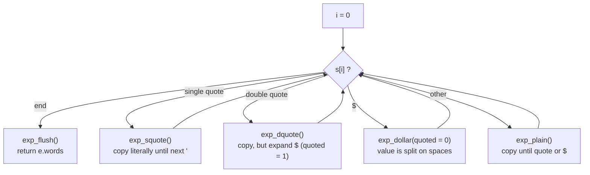
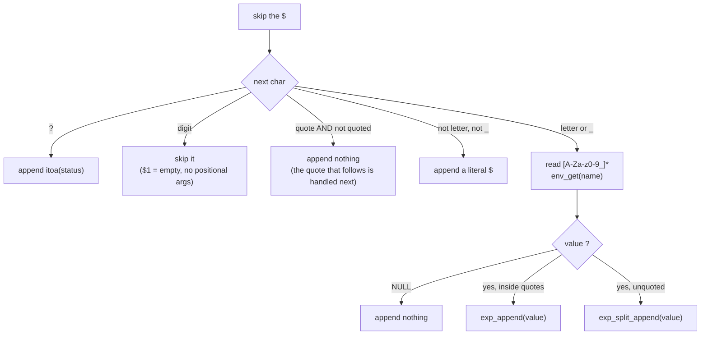

# `expander/` — Variables, quotes and word splitting

The expander turns the **raw text of one WORD token** into the final list of
arguments. It does three things in a single left-to-right pass:

1. **Quote removal** — `'...'` and `"..."` disappear, their content stays.
2. **Variable expansion** — `$NAME` and `$?` are replaced by their value.
3. **Word splitting** — an *unquoted* variable whose value contains spaces
   produces several arguments.

| File | Functions | Role |
|---|---|---|
| [`expand.c`](expand.c) | `expand_word`, `expand_heredoc_line`, `exp_squote`*, `exp_dquote`*, `exp_plain`* | Main pass, dispatch on quote type |
| [`expand_var.c`](expand_var.c) | `exp_dollar`, `var_name_len`*, `append_status`*, `append_dollar`* | Everything after a `$` |
| [`expand_utils.c`](expand_utils.c) | `exp_append`, `exp_flush`, `exp_split_append` | Building the words |

`*` = `static`. The expander is called by the **parser** (for arguments and
redirection files) and by the **heredoc** code (for heredoc lines).

---

## 1. The working state: `t_exp`

```c
typedef struct s_exp {
    t_list  *words;     // finished words (libft list of char *)
    char    *buf;       // word being built
    int     has_word;   // 1 if the current word "exists", even if empty
    t_shell *sh;        // to read env and $?
} t_exp;
```

Why `has_word`? To tell apart **an empty word** and **no word at all**:

| Input | Result | Why |
|---|---|---|
| `""` | one argument `""` | quotes were seen → `has_word = 1` |
| `$EMPTY` (unset) | **no** argument | nothing appended → `has_word = 0` |
| `"$EMPTY"` | one argument `""` | the `"` sets `has_word = 1` |

That is why `$EMPTY echo hi` prints `hi` (the empty word vanishes and `echo`
becomes the command), exactly like bash.

### The three building blocks (`expand_utils.c`)

```
exp_append(e, s, n)   buf = buf + s[0..n]        has_word = 1
exp_flush(e)          if has_word: push buf (or "") to words, reset buf
exp_split_append(e,v) for each chunk of v separated by ' ', '\t', '\n':
                          exp_append(chunk) ... exp_flush() at each separator
```

---

## 2. `expand_word()` — the dispatcher



Example — `a"b $X"'$Y'$X` with `X="1  2"`:

```
 part      handler       buf after          words
 ───────   ───────────   ────────────────   ─────────────
 a         exp_plain     "a"
 "b $X"    exp_dquote    "ab 1  2"          (quoted: no split)
 '$Y'      exp_squote    "ab 1  2$Y"        (literal)
 $X        exp_dollar    split "1  2":
                           "ab 1  2$Y1" ──flush──► ["ab 1  2$Y1"]
                           "2"
 end       exp_flush                        ["ab 1  2$Y1", "2"]
```

---

## 3. `exp_dollar()` — what follows a `$`



| Input | Output |
|---|---|
| `$?` / `$?HELLO` | `0` / `0HELLO` |
| `$HOME` | `/Users/me` |
| `$1abc` | `abc` |
| `$` / `"$"` / `$-` | the `$` is kept literally: `$`, `$`, `$-` |
| `$"HOME"` | `HOME` |
| `$UNSET` | nothing |

---

## 4. Word splitting in action

```
export A="x   y"

echo [$A]      →  args: "[x"  "y]"        →  prints  [x y]
echo ["$A"]    →  args: "[x   y]"         →  prints  [x   y]
```

Only space, tab and newline split words (the default `IFS`).

Splitting is also what produces the **ambiguous redirect** error: the parser
expands a redirection target, and if it gives anything other than exactly one
word, the file name is left `NULL` (see [parser](../parser/README.md)):

```
echo hi > $A   →  minishell: $A: ambiguous redirect      ($? = 1)
```

---

## 5. `expand_heredoc_line()` — heredoc bodies

Inside a heredoc body (when the delimiter was **not** quoted) only `$` is
special. Quotes are kept as normal characters and there is **no** splitting:

```
cat << EOF
'$USER' "$HOME"          →     'minks' "/Users/minks"
EOF
```

It uses the same `exp_dollar(..., quoted = 1)` and returns `e.buf` directly
(a single string, `""` if empty) instead of a list.
