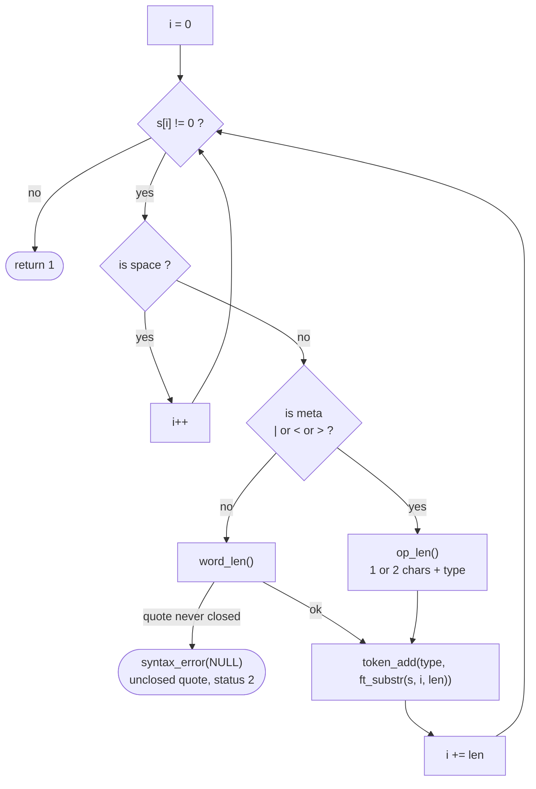
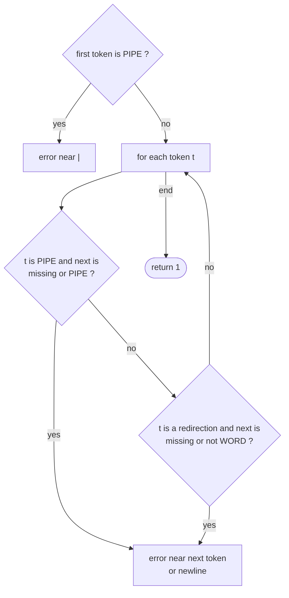

# `lexer/` — From a string to tokens

The lexer reads the raw line and cuts it into a linked list of **tokens**
(`sh->tokens`). Then the syntax checker verifies that those tokens are in a
valid order. Nothing is expanded here: quotes and `$` are kept as typed.

| File | Functions | Role |
|---|---|---|
| [`lexer.c`](lexer.c) | `lexer`, `is_meta`*, `op_len`*, `word_len`*, `token_add`* | Tokenization |
| [`syntax.c`](syntax.c) | `syntax_check`, `tok_name`* | Grammar check |

`*` = `static`

---

## 1. Token types

```c
typedef struct s_token { t_type type; char *value; struct s_token *next; } t_token;
```

| Text | Type |
|---|---|
| `\|` | `T_PIPE` |
| `<` | `T_IN` |
| `>` | `T_OUT` |
| `<<` | `T_HEREDOC` |
| `>>` | `T_APPEND` |
| anything else | `T_WORD` |

Only `|`, `<` and `>` are **metacharacters** (`is_meta`). `;`, `\`, `&`, `(`
are ordinary characters, as the subject asks.

---

## 2. `lexer()` — the scanning loop



### `op_len` — longest match first

```
"<<"  → T_HEREDOC (2)      "<"  → T_IN  (1)
">>"  → T_APPEND  (2)      ">"  → T_OUT (1)
"|"   → T_PIPE    (1)
```

So `<<<` becomes `<<` + `<`, which the syntax checker then rejects.

### `word_len` — words can contain quoted parts

A word goes on until a space or a metacharacter **outside quotes**. When a
quote is met, the scan jumps to the matching closing quote, so spaces and
metacharacters inside quotes stay in the word.

```
input:   echo "a | b"'c'd>out
         ──── ─────────── ─ ───
token:   WORD    WORD     OUT WORD
value:   echo  "a | b"'c'd  >  out
                 ▲
                 └ the | inside "..." is not a pipe
```

If the closing quote is missing, `word_len` returns 0 and the lexer reports
`minishell: syntax error: unclosed quote` (the subject says unclosed quotes
must not be interpreted).

### `token_add`

Allocates a `t_token` and appends it at the end of `sh->tokens`. The `value`
is a fresh `ft_substr` of the line, so the line can be freed independently.

---

## 3. `syntax_check()` — is the order of tokens valid?

Rules, checked from left to right:



| Line | Result |
|---|---|
| `\| ls` | ``syntax error near unexpected token `|'`` |
| `ls \|` | ``syntax error near unexpected token `newline'`` |
| `ls \|\| wc` | ``syntax error near unexpected token `|'`` |
| `cat <` | ``syntax error near unexpected token `newline'`` |
| `cat < > f` | ``syntax error near unexpected token `>'`` |
| `< f cat` | OK (a redirection may come first) |

`tok_name()` returns the value of the offending token, or `"newline"` when
the line ended too early — the same wording as bash.

On error, `syntax_error()` sets `$?` to **2** and the line is dropped
(nothing is executed, not even heredocs).
