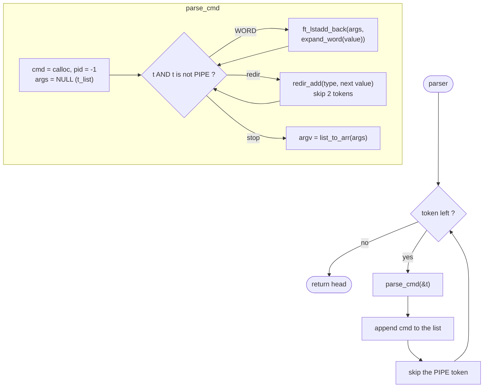
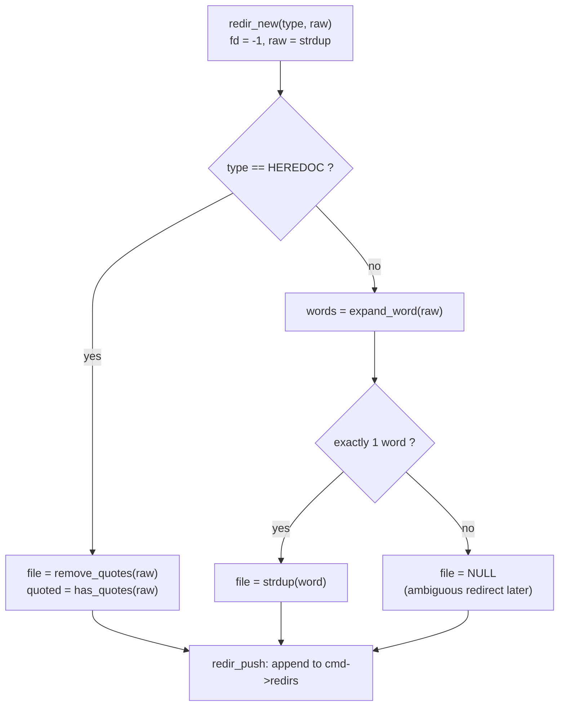

# `parser/` — From tokens to commands

The parser walks the token list and builds a linked list of `t_cmd`, one per
pipeline segment. While doing so it calls the **expander**, so every `argv`
it produces is final (no quotes, variables replaced).

| File | Functions | Role |
|---|---|---|
| [`parser.c`](parser.c) | `parser`, `parse_cmd`*, `list_to_arr`* | Build commands and their argv |
| [`redir.c`](redir.c) | `redir_add`, `remove_quotes`, `has_quotes`, `redir_new`*, `redir_push`* | Build redirections |

`*` = `static`. The parser trusts its input: `syntax_check` already ran, so a
redirection token is always followed by a WORD.

---

## 1. Output structure

```c
typedef struct s_cmd {
    char           **argv;    // NULL-terminated, may be {NULL} (only redirs)
    t_redir         *redirs;  // in the order they were written
    pid_t            pid;     // filled by the executor, -1 by default
    struct s_cmd    *next;    // next command of the pipeline
} t_cmd;

typedef struct s_redir {
    t_type           type;    // T_IN, T_OUT, T_APPEND, T_HEREDOC
    char            *file;    // expanded file name / heredoc delimiter
    char            *raw;     // text as typed (for error messages)
    int              quoted;  // heredoc: delimiter had quotes → no expansion
    int              fd;      // heredoc: fd of the prepared content, else -1
    struct s_redir  *next;
} t_redir;
```

Example: `< in grep "a b" > out | wc -l`

```
 tokens: IN in │ WORD grep │ WORD "a b" │ OUT > │ WORD out │ PIPE │ WORD wc │ WORD -l
         ─────────────────────── cmd 1 ─────────────────────────   ──── cmd 2 ────

 sh->cmds
   │
   ▼
 ┌─────────────────────────────┐      ┌─────────────────────────────┐
 │ argv:  ["grep", "a b", NULL]│ next │ argv:  ["wc", "-l", NULL]   │
 │ redirs:                     │ ───► │ redirs: NULL                │
 │   [IN  file="in"]           │      │ pid: -1                     │
 │      └─► [OUT file="out"]   │      └─────────────────────────────┘
 │ pid: -1                     │
 └─────────────────────────────┘
```

Redirections may appear anywhere among the words (`> out echo hi` is valid);
they are just collected separately from the arguments.

---

## 2. `parser()` and `parse_cmd()`



* `expand_word` returns a **list** (0, 1 or more words because of splitting),
  and `ft_lstadd_back` chains that whole list after the current arguments.
* `list_to_arr` converts the `t_list` into a `char **`. The strings are
  **moved**, not copied: each node's `content` is set to `NULL` before
  `ft_lstclear(lst, free)`, so only the nodes are freed and the strings now
  belong to `argv`.

```
args (t_list):  [ "grep" ]──►[ "a b" ]──►NULL
                    │            │
argv (char **): [  ptr0    ,   ptr1    , NULL ]     nodes freed, strings kept
```

---

## 3. `redir_add()` — two kinds of targets



### Heredoc delimiter: no expansion, only quote removal

| Typed | `file` (delimiter) | `quoted` | Body |
|---|---|---|---|
| `<< EOF` | `EOF` | 0 | `$VAR` expanded |
| `<< "EOF"` | `EOF` | 1 | kept literally |
| `<< 'E'OF` | `EOF` | 1 | kept literally |
| `<< $USER` | `$USER` | 0 | delimiter is literally `$USER` |

`remove_quotes` drops the outer quote characters and keeps everything inside.

### Normal redirection: expanded, must give one word

| Typed | `file` | At execution |
|---|---|---|
| `> out` | `out` | opens `out` |
| `> "my file"` | `my file` | opens `my file` |
| `> $EMPTY` | `NULL` | `minishell: $EMPTY: ambiguous redirect` |
| `> $A` (A=`x y`) | `NULL` | `minishell: $A: ambiguous redirect` |

The error is **not** raised here: the parser only stores `NULL`. The executor
reports it when it applies the redirection, so it happens in the right command
and in the right order (see [executor](../executor/README.md)). `raw` is kept
just for that message.
