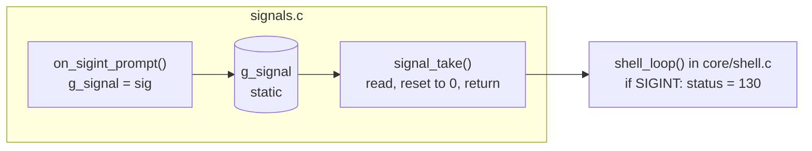
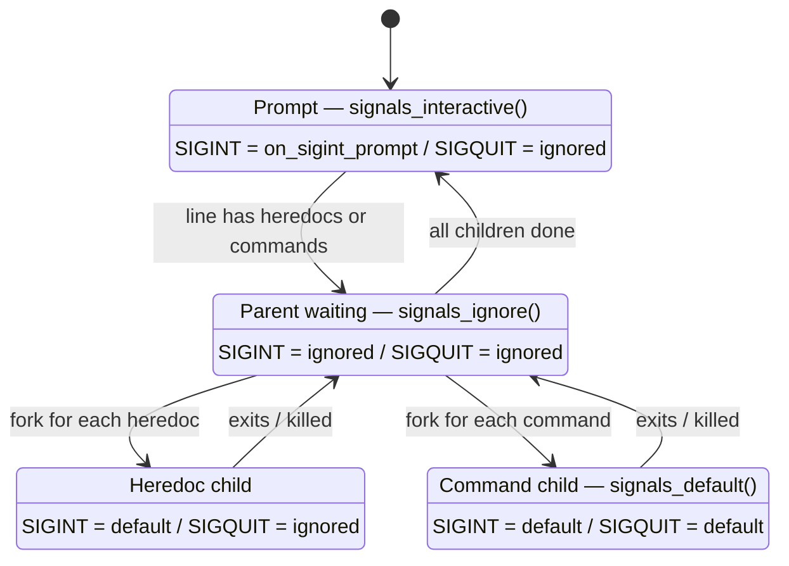
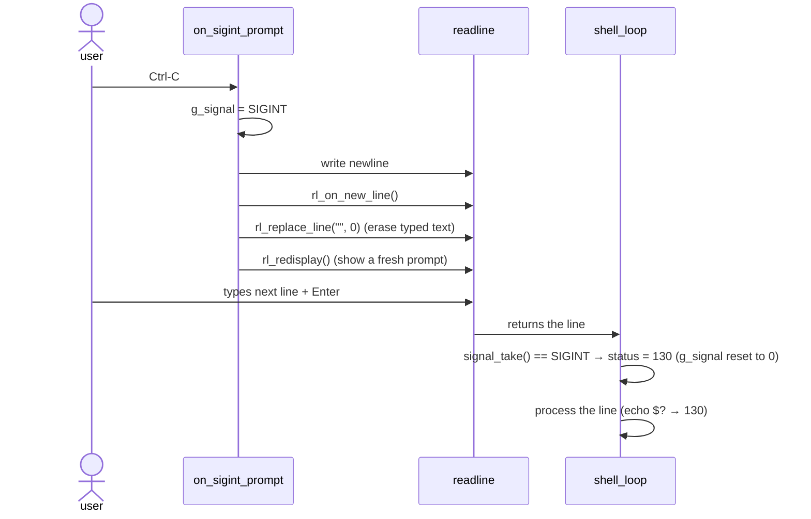

# `signals/` — Ctrl-C, Ctrl-\ and Ctrl-D

| File | Functions | Role |
|---|---|---|
| [`signals.c`](signals.c) | `signals_interactive`, `signals_ignore`, `signals_default`, `signal_take`, `on_sigint_prompt`* | Install the right handlers for each phase, report the last signal |

`*` = `static`

What the subject asks (interactive mode):

| Key | Signal | Expected |
|---|---|---|
| Ctrl-C | `SIGINT` | new prompt on a new line |
| Ctrl-\ | `SIGQUIT` | does nothing |
| Ctrl-D | *(not a signal)* | exits the shell |

Ctrl-D is **not** a signal: the terminal just reports end-of-file, so
`readline` returns `NULL` and `shell_loop` leaves (see [core](../core/README.md)).

---

## 1. The one global variable

```c
static volatile sig_atomic_t g_signal = 0;     // signals.c, the only global
```

The subject allows exactly one global, used only to store the signal number.

* **`sig_atomic_t`** — an integer type that is read and written in one
  uninterruptible operation, so the loop never sees a half-written value.
* **`volatile`** — forces the compiler to re-read the variable from memory
  each time, because a handler can change it at any moment.
* **`static`** — the variable is visible **only inside `signals.c`**. No other
  file can read or modify it, and there is no `extern` in `minishell.h`
  (so norminette reports a single `GLOBAL_VAR_DETECTED` notice).

The rest of the shell reads it through one function:

```c
int signal_take(void);   // returns the last signal received (0 if none) and resets it
```



The handler only stores the number: it never touches `t_shell` (it cannot
receive it as a parameter, and doing real work inside a handler is unsafe).

---

## 2. Which handler, when?

The behaviour changes with what the shell is doing. Each function installs a
complete set for one phase:



| Phase | Set by | `SIGINT` (Ctrl-C) | `SIGQUIT` (Ctrl-\) |
|---|---|---|---|
| prompt, interactive | `signals_interactive(1)` | `on_sigint_prompt` | ignored |
| prompt, non-interactive | `signals_interactive(0)` | default (shell dies, like bash) | ignored |
| parent during heredocs / pipeline | `signals_ignore()` | ignored | ignored |
| heredoc child | `hd_child` (executor) | default → child dies | ignored |
| command child | `signals_default()` | default → child dies | default → child dies + core |

**Why does the parent ignore signals while children run?** Ctrl-C is sent by
the terminal to **every** process of the foreground group. The child must
die, but the shell must survive and just report it.

---

## 3. Ctrl-C at the prompt



The status is set *after* `readline` returns, in the loop, not in the
handler, because a handler must stay minimal and cannot reach `t_shell`.

---

## 4. Ctrl-C / Ctrl-\ during a command

```
minishell$ sleep 10
^C                          ← child killed by SIGINT, parent prints "\n"
minishell$ echo $?
130
minishell$ sleep 10
^\Quit (core dumped)        ← child killed by SIGQUIT
minishell$ echo $?
131
```

The message and the status come from `wait_all` in
[`executor/pipeline.c`](../executor/pipeline.c): `128 + signal number`.

## 5. Ctrl-C during a heredoc

```
minishell$ cat << EOF
> hello
> ^C
minishell$ echo $?
130                         ← heredoc child killed, the whole line cancelled
```

Handled by `hd_fail` in [`executor/heredoc.c`](../executor/heredoc.c).
