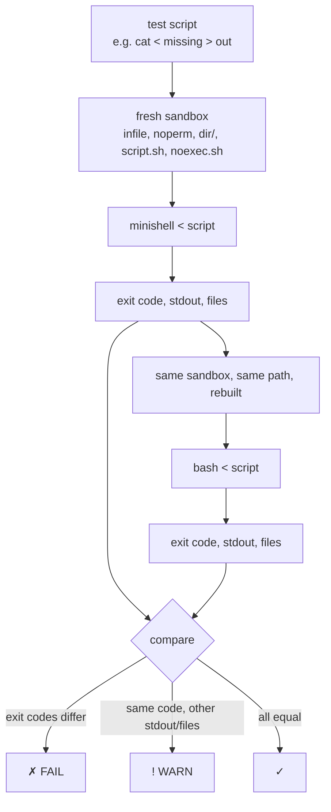

# `tests/` — Exit code tester

[`exit_code_tester.py`](exit_code_tester.py) runs the same input in
**minishell** and in **bash** and checks that both return the same exit code.

```bash
make                                   # build ./minishell first
python3 tests/exit_code_tester.py      # run everything (~40 s)
```

| Option | Effect |
|---|---|
| `--only CATEGORY` | Run one category (repeatable): `builtins`, `commands`, `expansion`, `syntax`, `pipes`, `redirections`, `heredoc`, `signals` |
| `-v` | Also list passing tests (with their exit code), show terminal output of failed signal tests |
| `--strict` | A different stdout or different files also count as a failure |
| `--bash PATH` | Compare with another bash, e.g. `--bash /bin/bash` |
| `--minishell PATH` | Test another binary |

The tester exits with 0 when nothing failed, 1 otherwise.

## How it works



* **Non-interactive parts** (builtins → heredoc): the test is sent on stdin,
  one command per line. The shell's exit code is the status of its last
  command. Both shells run in the **same directory path**, so `pwd` / `cd`
  outputs can be compared, and the files left behind (`out`, `o1`, …) are
  compared too, which checks the redirections.
* **Signals**: minishell and `bash --norc --noprofile -i` are started in a
  **pseudo-terminal** (like a real terminal), then the tester types commands
  and sends Ctrl-C (`\x03`), Ctrl-\ (`\x1c`) and Ctrl-D (`\x04`). Then it
  reads `$?` with `echo __ST:$?__`, or the exit code of the shell itself.

## Result marks

| Mark | Meaning |
|---|---|
| `✓` | Same exit code, same stdout, same files |
| `! WARN` | Same exit code, but stdout or files differ |
| `~ KNOWN` | Differs only because your bash is ≥ 5.3 (see below) |
| `✗ FAIL` | Different exit code |

## Known bash 5.3 differences

minishell follows bash ≤ 5.2 (the version on most 42 / Linux machines). bash
5.3 changed these exit codes, so with bash 5.3 they show as `~ KNOWN`, not as
failures:

| Command | bash ≤ 5.2 / minishell | bash 5.3 |
|---|---|---|
| `cd a b` | 1 | 2 |
| `exit 1 2` | 1 | 2 |

## Notes

* Error messages (stderr) are not compared: they are shown only for failures.
* Do not run as root: permission tests (`noperm`, `noexec.sh`) would be meaningless.
* A syntax error is always the **last** line of a test: bash in
  non-interactive mode stops the whole script on a syntax error, minishell
  goes on with the next line.
